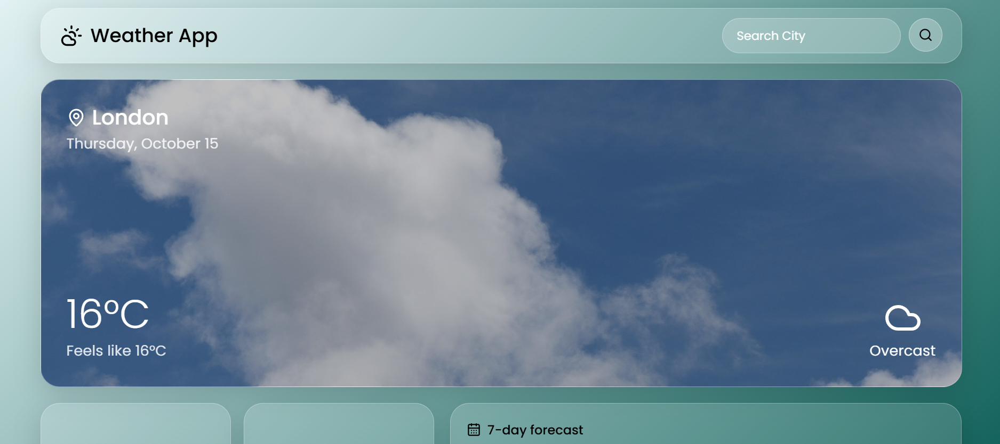
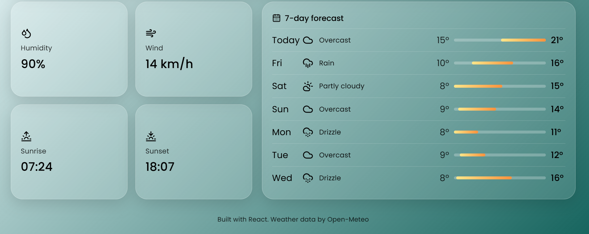

# Weather App

A responsive weather dashboard built with React. Search any city to see current conditions, sunrise and sunset times, and a 7-day forecast, all in a glassmorphism (frosted glass) interface.




**Live demo:** https://weatherapp-gf99.onrender.com/

## Features

- **City search** using a geocoding lookup, so any city in the world works
- **Current conditions** with temperature, "feels like", date, and a weather icon
- **Weather-based hero image** that changes with the conditions (clear, cloudy, fog, rain, snow, storm)
- **Info cards** for humidity, wind speed, sunrise, and sunset
- **7-day forecast** with icons, daily lows and highs, and a temperature range bar for each day
- **Loading and error states**, including a "City not found" message and network error handling
- **Responsive layout** that adapts from desktop to mobile

## Tech Stack

- [React](https://react.dev/) with [Vite](https://vitejs.dev/)
- [Open-Meteo API](https://open-meteo.com/) for geocoding and weather data (no API key required)
- [lucide-react](https://lucide.dev/) for icons
- Plain CSS (glassmorphism with `backdrop-filter`, flexbox, and grid)
- [Poppins](https://fonts.google.com/specimen/Poppins) from Google Fonts

## Getting Started

### Prerequisites

- [Node.js](https://nodejs.org/) (version 18 or newer)
- npm (comes with Node.js)

### Installation

```bash
# Clone the repository
git clone <your-repo-url>
cd WeatherApp

# Install dependencies
npm install

# Start the development server
npm run dev
```

Then open the local address printed in the terminal (usually `http://localhost:5173`).

### Build for production

```bash
npm run build
npm run preview
```

## Project Structure

```
WeatherApp/
├── index.html
├── package.json
└── src/
    ├── main.jsx
    ├── App.jsx               # State, data fetching, page layout
    ├── App.css               # All styling
    ├── assets/               # Weather background images
    ├── components/
    │   ├── Navbar.jsx
    │   ├── SearchBar.jsx
    │   ├── CurrentWeather.jsx  # Hero card
    │   ├── InfoCards.jsx       # Humidity, wind, sunrise, sunset
    │   ├── Forecast.jsx        # 7-day forecast panel
    │   └── Footer.jsx
    └── utils/
        └── weatherCodes.js     # Weather code to label, icon, and image
```

## How It Works

1. The user types a city name in the search bar.
2. `App` calls the **Open-Meteo geocoding API** to turn the city name into latitude and longitude.
3. It then calls the **Open-Meteo forecast API** with those coordinates to get current conditions and daily data.
4. The response is stored in React state and passed down to the components as props.
5. Weather codes (WMO codes) are translated into readable labels, icons, and background images in `WeatherCodes.js`.

## What I Learned

- Structuring a React app into reusable components and passing data with props
- Managing state with `useState` and loading data with `useEffect`
- Chaining multiple `async/await` API requests with `try / catch / finally`
- Rendering lists with `.map()` and keys
- Conditional rendering for loading, error, and empty states
- Building a responsive layout with CSS grid and flexbox, and creating a glass effect with `backdrop-filter`


## Credits

- Weather data by [Open-Meteo](https://open-meteo.com/) (licensed under CC BY 4.0)
- Icons by [Lucide](https://lucide.dev/)
- Background images: from Pexels.
